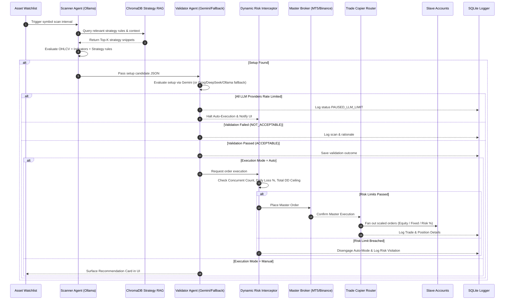

# Meruem — Product Requirements Document (PRD)

> [!NOTE]  
> **Document Version:** v0.2 — OpenCode CLI / DeepSeek-V4 Flash Build Planning  
> **Owner:** Gerald  
> **Target Environment:** Acer Aspire 7 (16GB RAM, NVIDIA RTX 3050 Ti 4GB VRAM, Windows OS)  
> **Budget / Constraints:** $0 External Budget (Open-Source & Free-Tier Services Only)  
> **Predecessor System:** [Oddyseus Python Pipeline](https://github.com/sensesVoid/Oddyseus)

---

## 1. Executive Summary & Vision

**Meruem** is a local-first, AI-agentic desktop application that automates Gerald's full discretionary-to-systematic trading lifecycle:
1. **Scan** financial markets continuously using local LLMs and technical indicators.
2. **Validate** trade candidate setups using a secondary, high-intelligence AI opinion via a multi-provider fallback chain.
3. **Execute & Fan Out** orders to master and slave trading accounts with real-time risk interception and dynamic lot-scaling rules.
4. **Manage** trades dynamically across multi-tier take profits (TP1–TP4), trailing stops, and automated break-even levels.
5. **Log & Audit** system performance on a rolling 7-day cycle against customizable risk and performance profiles.
6. **Optimize** strategy rules autonomously by synthesizing past performance into backtested draft strategies for human approval.

Meruem elevates the prototype *Oddyseus* script/notebook pipeline into a production-grade multi-pane desktop environment backed by persistent vector search (RAG), strict dynamic risk guardrails, and multi-broker support.

---

## 2. Scope Boundaries

### 2.1 Goals
* **Local-First & Resource Efficient:** Native desktop shell with minimal idle memory usage, executing Python sidecars locally.
* **Multi-Agent Governance:** Decoupled specialized AI agents for Scanning, Validation, Auditing, and Optimization.
* **Resilient Intelligence:** Dynamic LLM fallback chain to guarantee operational continuity during API rate limits.
* **Master-Slave Trade Replication:** Fan out master trades to slave accounts with multi-modal lot sizing methods.
* **Dynamic Risk Interception:** Hard safety guardrails enforcing daily equity loss disengagement ceilings and total drawdown limits prior to order submission.

### 2.2 Non-Goals (v1)
* **Multi-Tenant / Public Cloud SaaS:** Built exclusively for a single user on a single local machine.
* **High-Frequency / Microsecond Trading (HFT):** Designed for swing and intraday discretionary/AI-assisted setups where latency budget is in seconds, not microseconds.
* **Custom Charting Engine:** Uses `@tradingview/lightweight-charts` rather than building a custom charting engine from scratch.
* **Native cTrader MVP:** cTrader integration is explicitly deferred to Phase 2 (MT5 and Binance are primary MVP targets).

### 2.3 Broker & Exchange Terms of Service (TOS) Compliance
> [!WARNING]  
> Automated order placement against MT5, Binance, or cTrader must comply with each broker's and prop firm's Terms of Service regarding bot trading, automated execution, and IP/disclosure rules. TOS validation must be checked prior to enabling live "Auto-Execution" mode per account.

---

## 3. High-Level Architecture

```
┌───────────────────────────────────────────────────────────────────────────────────┐
│                           Tauri Desktop Shell (Rust)                              │
│  ┌─────────────────────────────────────────────────────────────────────────────┐  │
│  │                  Frontend (React + TypeScript + Tailwind)                   │  │
│  │  Panes: TradingView | News | Asset Watchlist | Open Trades / Position Mgr   │  │
│  │  Panes: Strategy Library | Audit Dashboard | Settings & Vault              │  │
│  └─────────────────────────────────────────────────────────────────────────────┘  │
│                           ↕ IPC / localhost REST + WebSocket                      │
└───────────────────────────────────────────────────────────────────────────────────┘
                                         ↕
┌───────────────────────────────────────────────────────────────────────────────────┐
│                     Python Backend (FastAPI + Uvicorn Sidecar)                     │
│                                                                                   │
│  ├── Scanner Agent (Ollama: qwen2.5:3b / phi3.5)                                  │
│  ├── Validator Agent (Gemini 2.0 Flash → Groq / DeepSeek → Ollama Fallback)       │
│  ├── Strategy RAG Layer (ChromaDB + sentence-transformers / nomic-embed-text)     │
│  ├── Broker Adapters (MetaTrader 5 | Binance ccxt | cTrader Phase 2)              │
│  ├── Dynamic Risk Interceptor & Safety Engine                                     │
│  ├── Trade Copier / Multi-Account Router (Master → Slaves)                        │
│  ├── Execution & Position Manager (TP1–4, Trailing Stop, Auto-Breakeven)          │
│  ├── News & Economic Calendar Aggregator (RSS, GDELT, CryptoPanic)                │
│  ├── Data Store & Logger (SQLite via SQLModel / SQLAlchemy)                       │
│  ├── Audit Agent (APScheduler 7-Day Performance Evaluator)                        │
│  ├── Backtest Engine (backtesting.py / vectorbt)                                  │
│  ├── Strategy Optimizer Agent (Synthesizes & Backtests DRAFT strategies)           │
│  └── Credential Vault Bridge (OS Keychain via `keyring`)                           │
└───────────────────────────────────────────────────────────────────────────────────┘
                                         ↕
           [ MT5 Terminal ]   │   [ Binance API ]   │   [ cTrader OpenAPI ]
```

**Architecture Rationale:**  
Tauri provides a native, low-RAM footprint (~10x lighter than Electron) and secure integration with the OS credential vault. All core algorithmic trading, vector retrieval, and broker interfaces remain in Python sidecar processes, enabling direct reuse of existing *Oddyseus* modules without rewriting trading logic in Rust.

---

## 4. Technology Stack

| Layer | Technology Choice | Selection Rationale |
| :--- | :--- | :--- |
| **Desktop Shell** | Tauri 2.x (Rust) | Native performance, minimal VRAM/RAM overhead, lightweight bundler. |
| **Frontend UI** | React + TypeScript + Tailwind CSS + shadcn/ui | Component-driven, responsive dashboard interface. |
| **Charting Engine** | `@tradingview/lightweight-charts` | Open-source (MIT), zero approval needed, ultra-fast canvas rendering. |
| **Backend Framework** | FastAPI + Uvicorn (Python Sidecar) | Asynchronous REST and WebSockets for real-time price & trade streams. |
| **Local Scanner LLM** | Ollama (`qwen2.5:3b-instruct` / `phi3.5`) | Runs locally on CPU/GPU without consuming cloud credits; fast setup recall. |
| **Cloud Validator LLM**| Primary: Gemini 2.0 Flash<br>Secondary: Groq / DeepSeek API<br>Tertiary: Local Ollama (`qwen2.5-coder:7b`) | Pluggable multi-provider pipeline guaranteeing operational continuity. |
| **RAG Vector Database**| ChromaDB (Embedded Persistent Mode) | Zero infrastructure overhead; local vector search matching Oddyseus models. |
| **Embeddings Model** | `sentence-transformers/all-MiniLM-L6-v2` or `nomic-embed-text` | Efficient CPU/GPU execution without competing with local LLM VRAM. |
| **MT5 Connectivity** | `MetaTrader5` Python API | Official Python package; proven integration in GoldFlow/IB EAs context. |
| **Binance Connectivity**| `ccxt` / `python-binance` | Unified, multi-exchange REST and WebSocket abstraction. |
| **cTrader Connectivity**| `ctrader-open-api` (Phase 2) | Official Spotware OpenAPI client. |
| **Database & ORM** | SQLite + SQLModel / SQLAlchemy | Single-file local storage for settings, scan logs, trade logs, and audits. |
| **Scheduler** | APScheduler | Manages 7-day audit cycles and background scanner intervals. |
| **Backtesting Engine** | `backtesting.py` / `vectorbt` | Lightweight Python backtest framework compatible with strategy objects. |
| **News Feed** | RSS Aggregator (ForexFactory, CryptoPanic, GDELT) | Macro awareness and economic event tracking. |
| **Credential Storage** | `keyring` (OS Native Keychain) | Encrypted storage for broker API keys, master passwords, and API tokens. |

---

## 5. Core Module Specifications

### 5.1 Scanner Agent (Ollama)
* **Function:** Evaluates active symbols in the watchlist on user-configured intervals.
* **Context Inputs:** Recent OHLCV data, calculated technical indicators (candle geometry, Volume Profile), and Top-K strategy snippets retrieved from ChromaDB.
* **Output Format:** Structured JSON candidate setup:
  ```json
  {
    "asset": "XAUUSD",
    "timeframe": "15m",
    "direction": "BUY",
    "entry_zone": [2640.50, 2642.00],
    "invalidation": 2635.00,
    "strategy_refs": ["vol_profile_breakout_v2"],
    "confidence": 0.82,
    "rationale": "Bullish imbalance setup aligned with daily trend and VP POC support."
  }
  ```
* **Design Intent:** Optimized for high recall (ensuring setups are not missed) using lightweight local models.

### 5.2 Validator Agent (Cloud LLM & Fallback Chain)
* **Function:** Receives candidate setups from the Scanner Agent, combines them with deeper market context and RAG rules, and provides a secondary AI verification.
* **Multi-Provider Fallback Pipeline:**
  1. **Primary:** Gemini 2.0 Flash API (`google-generativeai`)
  2. **Secondary Fallback:** Groq API / DeepSeek API
  3. **Tertiary Fallback:** Local Ollama model (`qwen2.5-coder:7b`)
  4. **Fail-Safe Mode:** If all providers fail or hit rate limits, system transitions to `PAUSED_LLM_LIMIT` status, logs details to SQLite, notifies the UI, and halts automated execution until manually cleared.
* **Output:** Status (`ACCEPTABLE` or `NOT_ACCEPTABLE`), detailed reasoning, and recommended Multi-Tier Take Profit (TP1–TP4) & Stop Loss (SL) levels.

### 5.3 Execution & Multi-Account Copier Layer
* **Execution Modes:**
  * **Manual Mode:** UI presents one-click executable recommendation cards with pre-filled, editable entry/SL/TP parameters.
  * **Auto-Execution Mode:** Toggled globally or per-asset; automatically places trades when validated.
* **Dynamic Risk Interceptor:** Intercepts every order before execution and evaluates against user rules in SQLite:
  * **Max Concurrent Auto-Trades:** Default `2` (configurable).
  * **Max Daily Auto-Loss Cap:** Default `-3.0%` of starting daily equity. Upon breach, auto-execution mode is disengaged automatically.
  * **Max Hard Drawdown Ceiling:** Default `-8.0%` overall equity drawdown. Reaching this limit disengages auto-mode and blocks all automated trade execution.
* **Master-Slave Lot Scaling Engine:**  
  Executes orders on the Master account and fans out executions to connected Slave accounts using configurable scaling formulas:
  * **Proportional Equity Sizing:**  
    $$\text{Slave Lot} = \text{Master Lot} \times \left( \frac{\text{Slave Equity}}{\text{Master Equity}} \right) \times \text{User Scale Factor}$$
  * **Fixed Multiplier Sizing:**  
    $$\text{Slave Lot} = \text{Master Lot} \times \text{Multiplier}$$
  * **Custom Risk % Override:**  
    Calculates lot sizes independently per slave account based on individual equity and trade Stop Loss distance:
    $$\text{Slave Lot} = \frac{\text{Slave Equity} \times \text{Custom Risk \%}}{\text{SL Distance (pips)} \times \text{Pip Value}}$$

### 5.4 Position & Trade Management
* **Open Positions View:** Live grid display showing open positions per account with full/partial close controls.
* **Multi-Tier Take Profit (TP1–TP4):** AI pre-fills target levels; user can dynamically add, edit, or remove targets.
* **Automated Risk Management:**
  * **Auto-Breakeven (Auto-BE):** Moves SL to entry price upon reaching TP1 or a pre-configured R-multiple.
  * **Trailing Stop Engine:** Dynamic trailing stop activation based on price progress.

### 5.5 Logging & 7-Day Audit Agent
* **Logging:** Writes all scanner signals, validation decisions, risk checks, and trade lifecycle events to SQLite.
* **Periodic Audit Loop:** Runs every 7 days via APScheduler to evaluate rolling performance metrics (Win Rate, Profit Factor, Expectancy, Max Drawdown) against selectable baseline profiles:
  * **Prop Firm Challenge Baseline:** Win Rate $\ge 45\%$, Profit Factor $\ge 1.5$, Max DD $\le 5.0\%$
  * **Conservative Preset (Live Account):** Win Rate $\ge 50\%$, Profit Factor $\ge 1.8$, Max DD $\le 4.0\%$
  * **Aggressive Preset (Push Phase):** Win Rate $\ge 40\%$, Profit Factor $\ge 1.3$, Max DD $\le 7.0\%$
  * **Custom Preset:** User-defined metric boundaries.
* **Human-in-the-Loop Governance:** If metrics degrade, the Audit Agent generates actionable adjustment recommendations queued in the UI for user approval before applying changes to live configs.

### 5.6 Strategy Optimizer Agent & Backtester
* **Backtester:** Integrates `backtesting.py` to evaluate strategy rules against historical market data (e.g., XAUUSD, BTC, EURUSD).
* **Optimizer Agent:** Analyzes past trade logs and historical performance, synthesizes new derived/composite strategies, runs automated backtests, and saves generated strategies with `DRAFT` status pending user review and promotion to `ACTIVE`.

---

## 6. Workspace UI & Panels

1. **Chart View:** `@tradingview/lightweight-charts` pane synced with the selected symbol in Asset Watchlist.
2. **Asset Watchlist:** Configurable symbol watchlist monitored by the Scanner Agent.
3. **News & Economic Calendar:** Real-time macro event feed filtered by watched assets (ForexFactory, CryptoPanic, GDELT).
4. **Open Trades & Position Manager:** Real-time management pane for open positions, multi-TP controls, and account performance.
5. **Strategy Library Tab:** CRUD interface for strategy documents (markdown + metadata), automatically embedded into ChromaDB upon saving.
6. **Audit Dashboard:** Visual performance overview comparing rolling 7-day stats against target threshold profiles.
7. **Settings & Vault View:** Central UI for updating risk limits, lot sizing algorithms, LLM API keys, and managing encrypted credentials stored via `keyring`.

---

## 7. Database Schema (SQLite)

```sql
-- Accounts (Master and Slave configuration)
CREATE TABLE accounts (
    id TEXT PRIMARY KEY,
    broker TEXT NOT NULL,                  -- 'MT5', 'Binance', 'cTrader'
    account_type TEXT NOT NULL,            -- 'master', 'slave'
    nickname TEXT NOT NULL,
    risk_scaling_mode TEXT NOT NULL,       -- 'proportional', 'fixed', 'risk_pct'
    scale_factor REAL DEFAULT 1.0,
    encrypted_ref TEXT NOT NULL            -- Reference key in OS keyring
);

-- Asset Watchlist
CREATE TABLE assets (
    id TEXT PRIMARY KEY,
    symbol TEXT NOT NULL UNIQUE,
    asset_class TEXT NOT NULL,            -- 'forex', 'crypto', 'commodities'
    timeframe_watchlist TEXT NOT NULL     -- Comma-separated timeframes e.g., '15m,1h'
);

-- Strategy Knowledge Base
CREATE TABLE strategies (
    id TEXT PRIMARY KEY,
    name TEXT NOT NULL,
    body_markdown TEXT NOT NULL,
    asset_class TEXT NOT NULL,
    timeframe TEXT NOT NULL,
    created_at TIMESTAMP DEFAULT CURRENT_TIMESTAMP,
    embedding_id TEXT,
    status TEXT NOT NULL                  -- 'active', 'draft', 'archived'
);

-- Scan Logs
CREATE TABLE scans (
    id TEXT PRIMARY KEY,
    asset_id TEXT REFERENCES assets(id),
    timestamp TIMESTAMP DEFAULT CURRENT_TIMESTAMP,
    scanner_output_json TEXT NOT NULL,
    strategy_refs TEXT                     -- JSON array of strategy IDs
);

-- Validation Logs
CREATE TABLE validations (
    id TEXT PRIMARY KEY,
    scan_id TEXT REFERENCES scans(id),
    verdict TEXT NOT NULL,                 -- 'ACCEPTABLE', 'NOT_ACCEPTABLE'
    rationale TEXT NOT NULL,
    suggested_levels_json TEXT NOT NULL,   -- TP1..TP4, SL
    provider_used TEXT NOT NULL            -- 'gemini', 'groq', 'deepseek', 'ollama'
);

-- Trade Execution Logs
CREATE TABLE trades (
    id TEXT PRIMARY KEY,
    account_id TEXT REFERENCES accounts(id),
    scan_id TEXT REFERENCES scans(id),
    entry_price REAL NOT NULL,
    sl REAL NOT NULL,
    tp1 REAL, tp2 REAL, tp3 REAL, tp4 REAL,
    direction TEXT NOT NULL,               -- 'BUY', 'SELL'
    opened_at TIMESTAMP DEFAULT CURRENT_TIMESTAMP,
    closed_at TIMESTAMP,
    pnl REAL,
    mode TEXT NOT NULL                     -- 'manual', 'auto'
);

-- Performance Audit Reports
CREATE TABLE audit_reports (
    id TEXT PRIMARY KEY,
    period_start TIMESTAMP NOT NULL,
    period_end TIMESTAMP NOT NULL,
    metrics_json TEXT NOT NULL,
    recommendations_json TEXT NOT NULL,
    approved_bool INTEGER DEFAULT 0
);

-- Dynamic System Settings & Risk Parameters
CREATE TABLE settings (
    id TEXT PRIMARY KEY,
    key TEXT UNIQUE NOT NULL,
    value_json TEXT NOT NULL,
    updated_at TIMESTAMP DEFAULT CURRENT_TIMESTAMP
);
```

---

## 8. Multi-Agent Orchestration Workflow



---

## 9. Implementation Roadmap & Phases

| Phase | Phase Name | Focus & Key Deliverables |
| :---: | :--- | :--- |
| **Phase 0** | **Scaffold & System Core** | Tauri 2.x shell + FastAPI sidecar execution setup; SQLite database initialization; `keyring` OS credential vault integration. |
| **Phase 1** | **Scan, Validation & Fallback Pipeline** | Ollama local scanner + Gemini validator; Groq/DeepSeek/Ollama multi-provider fallback chain; MT5 market reader; Watchlist & Recommendation Card UI. |
| **Phase 2** | **Risk Interceptor & Multi-Account Copier** | Settings UI for dynamic risk guardrails (daily loss %, drawdown ceiling, trade caps); MT5 order execution engine; Master-Slave lot-scaling Copier engine; Auto-BE & Trailing Stop controls. |
| **Phase 3** | **Strategy RAG & Knowledge Base** | Embedded ChromaDB integration; Strategy Library CRUD UI; automated embedding generation; dynamic context injection into agent prompts. |
| **Phase 4** | **Audit Dashboard & Strategy Optimizer** | APScheduler 7-day audit loop; `backtesting.py` integration; Audit Dashboard UI; human-in-the-loop approval workflow for AI-generated strategy proposals. |
| **Phase 5** | **cTrader Integration & Final Polish** | `ctrader-open-api` integration; News feed aggregation (GDELT / CryptoPanic); UX micro-animations; comprehensive end-to-end fail-safe testing. |

---

## 10. Acceptance & Verification Criteria

1. **Dynamic Risk Control Verification:** Modifying risk thresholds (Daily Loss %, Total Drawdown Ceiling, Max Auto-Trades) via Settings UI immediately enforces restrictions on backend order processing without requiring application restart.
2. **Trade Copier Accuracy:** Master account order execution automatically triggers proportional or fixed scaled orders across all connected slave accounts in accordance with defined formulas.
3. **LLM Fallback Resilience:** When primary cloud LLM endpoints fail or rate-limit, the system seamlessly degrades down the fallback chain (Gemini → Groq/DeepSeek → Ollama → `PAUSED_LLM_LIMIT`) without crashing, hanging, or executing unvalidated orders.
4. **Prop Firm Loss Safeguard:** Exceeding the maximum daily loss cap disengages auto-trading mode instantly and disallows any subsequent automated executions until reset by the user.
5. **Code & Architecture Integrity:** Clear separation between Tauri shell, FastAPI backend services, SQLite persistence, and external broker adapters.